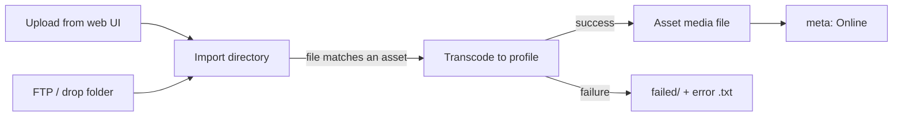

# Media Upload & Import

Watch folders create new assets from files. Media upload and import work the other way around: the asset already exists in Nebula (usually created by hand as an *Offline* placeholder), and a media file is delivered for it later.

Nebula supports two ways of doing that:

* **Direct upload:** the file uploaded from the web interface is stored as the asset's media file as is.
* **Import:** the file is handed to the `import` service, which transcodes it to your house format (for example XDCAM HD422) and then stores it as the asset's media file. The same service can also watch drop folders (e.g. FTP) for files named after an asset.

---

## Uploading from the Web Interface

When uploads are enabled, the asset editor shows an **Upload** button for existing file assets. Select a file and Nebula uploads it in the background; you can keep working and follow the progress in the upload monitor.

Nebula accepts the file only if:

* the asset is a file asset (not a virtual one),
* the file type matches the asset's content type (a video file for a video asset).

Uploads are enabled by default. To hide the button, set `ui_asset_upload` to `False` in the system settings (`settings/settings.py`):

```python
SETTINGS = {
    "ui_asset_upload": False,
}
```

What happens to the uploaded file depends on whether an upload storage is configured.

---

## Direct Upload

Without an upload storage, the uploaded file **replaces the asset's media file directly**. No transcoding is done, so this mode fits setups where users deliver files already in the right format.

1. The file is written to a temporary file on the asset's storage, then moved to the asset's path. If the file has a different extension than the asset path, the path is updated to match it.
2. The asset status is set to *Creating*.
3. The `meta` service probes the new file, updates technical metadata and turns the asset *Online*.

!!! note
    The asset must already have a target storage and path. For assets created manually, these are assigned by the [asset validator](validators.md) when the asset is first saved. Without them, uploads and imports for the asset fail.

---

## Upload Through the Import Service

To transcode uploads to your house format, configure an upload storage and directory in the system settings (`settings/settings.py`):

```python
SETTINGS = {
    "upload_storage": 1,
    "upload_dir": "import",
    "upload_base_name": "{id}",
}
```

| Setting | Default | Description |
| --- | --- | --- |
| `upload_storage` | - | Storage ID where uploaded files are placed. |
| `upload_dir` | - | Directory on that storage where uploaded files are placed. |
| `upload_base_name` | `{id}` | File name of the uploaded file (without extension). Formatted with the asset metadata, e.g. `{id}` or `{id/main}`. |

An uploaded file is then saved as `<upload_dir>/<upload_base_name>.<extension>` (for example `import/1234.mov`), and the import service takes over.

You also need the import service and an import action, described below.

---

## The Import Service

The `import` service watches one or more import directories. For each file it finds, it:

1. Waits until the file stops growing (its size must be the same on two consecutive checks).
2. Finds the asset the file belongs to: the file name (without extension) must match the asset's metadata field set as `identifier` (by default the asset ID).
3. Transcodes the file to the profile of the import action, into a temporary file.
4. Moves the asset's current media file, if there is one, to a version backup (`.nx/versions/` on the asset's storage), and moves the new file into its place.
5. Moves the source file to the `backup/` subdirectory of the import directory.
6. Clears the asset's technical and QC metadata. The `meta` service then probes the new file and turns the asset *Online*, and jobs of the asset (for example proxy creation) are restarted.



Only video files are picked up.

### Service Configuration

Register a single instance of the service in `settings/services.py`:

```python
from nebula.settings.models import ServiceSettings

SERVICES = [
    # ... other services
    ServiceSettings(id=6, type="import", name="import", host="worker"),
]
```

### Import Actions

Each import directory is configured as an action with the service type `import` (`settings/actions.py`). An action without `id_storage` and `import_dir` uses the upload storage and directory from the system settings, so for web uploads a minimal action is enough:

```python
from nebula.settings.models import ActionSettings

import_settings = """
<settings>
    <profile>xdcamhd422-1080i50</profile>
</settings>
"""

ACTIONS = [
    # ... other actions
    ActionSettings(id=2, name="import", type="import", settings=import_settings),
]
```

| Element | Default | Description |
| --- | --- | --- |
| `id_storage` | `upload_storage` | Storage ID of the import directory. |
| `import_dir` | `upload_dir` | Directory on that storage to watch. Created automatically when the service starts. |
| `identifier` | `id` | Asset metadata field the file name is matched against. |
| `profile` | `xdcamhd422-1080i50` | Target format, see [Import Profiles](#import-profiles). |

!!! warning "Keep the file name and identifier in sync"
    For web uploads, `upload_base_name` must produce the value that `identifier` matches. The defaults (`{id}` and `id`) do. If you change one, for example to match on `id/main`, change both: `upload_base_name = "{id/main}"` and `<identifier>id/main</identifier>`.

The import service reads its actions when it starts. Restart the worker after changing them.

### Drop Folders

You can add more import actions, each watching its own directory, for example an FTP upload folder. Files dropped there must be named after the asset's identifier:

```xml
<settings>
    <id_storage>1</id_storage>
    <import_dir>ftp/incoming</import_dir>
    <identifier>id/main</identifier>
    <profile>xdcamhd422-1080i5994</profile>
</settings>
```

A file whose name matches no asset stays in the directory, and an error file with the same name and a `.txt` extension is written next to it (e.g. `ABC123.txt` for `ABC123.mov`). Once the media file is removed, the error file is cleaned up by the next import from that directory.

### Failed Imports

If transcoding fails, the asset is left untouched: its current media file and status don't change. The source file is moved to the `failed/` subdirectory of the import directory, together with a `.txt` file containing the error reported by FFmpeg. The import job in the jobs list shows the first line of the error.

To retry, move the file from `failed/` back to the import directory, or upload it again.

---

## Import Profiles

A profile defines the target format of an import. These profiles are included:

| Profile | Format |
| --- | --- |
| `xdcamhd422-1080i50` | XDCAM HD422 1080i50 (PAL): MPEG-2 4:2:2, 50 Mbps, closed GOP 12, PCM audio |
| `xdcamhd422-1080i5994` | XDCAM HD422 1080i59.94 (NTSC): MPEG-2 4:2:2, 50 Mbps, closed GOP 15, PCM audio |

Both are meant for `.mxf` asset paths.

### Fast Import

If the source video already matches the profile (for example an XDCAM HD422 1080i50 file imported with the `xdcamhd422-1080i50` profile), the video stream is copied instead of re-encoded. Only the audio is converted. This makes importing files that are already in the house format nearly instant.

### Profile Files

Each profile is a TOML file in the worker's `services/import/profiles/` directory, named after the profile (`<name>.toml`). The profiles are loaded when the import service starts; an action that uses an unknown profile is skipped and an error is logged.

```toml
# "smca": merge several mono audio tracks into one multichannel track
audio_layout = "smca"

# FFmpeg video options for transcoding
video_encoding = [
    "-r", "25",
    "-pix_fmt", "yuv422p",
    "-c:v", "mpeg2video",
    # ...
    "-b:v", "50M",
]

# FFmpeg video options for a fast import (default: ["-c:v", "copy"])
video_copy = ["-c:v", "copy", "-b:v", "50M"]

# FFmpeg audio options
audio_encoding = ["-ar", "48000", "-c:a", "pcm_s16le"]

# Sources matching all keys of any entry use fast import.
# Keys: commercial_name, width, height, fps, aspect
[[video_fast_import]]
commercial_name = "XDCAM HD422"
fps = 25
width = 1920
height = 1080
```

!!! note "Current limitations"
    * Profiles don't scale the video: a 720p source stays 720p.
    * Fast import doesn't check the scan type, so a progressive 1080p25 XDCAM file matches the 1080i50 profile and is copied as is.
    * Audio and image files are not imported.

---

## Uploading via the API

The web interface uploads files with a single HTTP request, which you can also use from your own tools:

```bash
curl -X POST "https://nebula.example.com/upload/1234" \
    -H "Authorization: Bearer $TOKEN" \
    -H "X-nebula-extension: mov" \
    --data-binary @clip.mov
```

The asset ID is part of the URL, the request body is the file itself, and the `X-nebula-extension` header gives its file extension. The file then goes through direct upload or the import service, as configured above.
