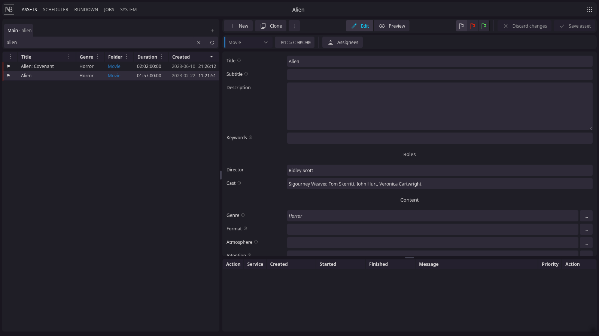
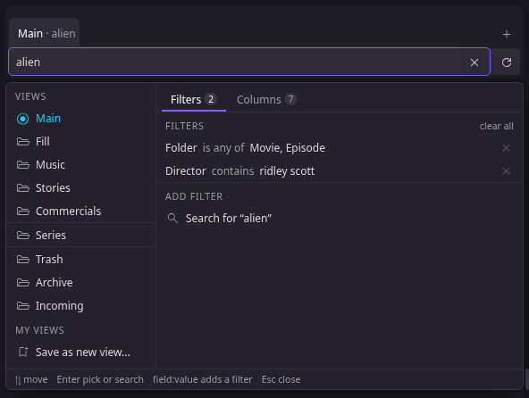

# Asset Browser

The **Asset Browser** on the left of the MAM pages is where you find assets: to open them in the editor, drag them to the rundown or the scheduler, or act on many at once. It works with tabs, like a web browser, so you can keep several searches open and switch between them without losing your place.

From the top: the **tabs** (with **+** for a new one), the **filter bar** (with **⟳** to reload), and the assets. The asset you click opens in the editor on the right.

---

## Tabs

Each tab is its own browser: it has a **view**, its own **filters**, **search**, **sort** and **columns**, and remembers its scroll position and which rows are selected.

* **New tab:** the **+** at the right end of the tab bar. The new tab starts with the view of the tab you were in, as the view defines it (without the filters you added).
* **Close a tab:** the **×** on the tab, or a middle click. The last tab can't be closed.
* **Switching tabs** is instant. Nothing is reloaded, and you come back to the same rows at the same scroll position.
* **The tab label** is the view's name, followed by the search, if there is one.

Your tabs (views, filters, searches, sorts and columns) are restored when you reload the page. Rows, scroll positions and selections are not.

!!! note "Tabs and your own views live in the web browser"
    They are stored in the web browser you use, not on the server. Another computer, another web browser or a private window starts with one tab of the first view, and none of your own views. On a shared computer, everyone who logs in with the same web browser shares the same tabs and views.

---

## Views

A **view** is a starting point for a tab: which assets it shows, which columns, and in what order. Click the filter bar to open the popover; the views are in its left column.

* **Views** are the site's views, set up by the administrator (`views.py`, see [Settings System](../setup/configuring_nebula.md)). Typically one per kind of content: movies, episodes, commercials, trash...
* **My views** are the ones you saved yourself.

Picking a view replaces the tab's filters, search, sort and columns with the view's. The view's folders and statuses become ordinary filters (`Folder is any of ...`, `Status is any of ...`), so you can change or remove them like any other.

When the tab's filters or search differ from its view, the filter bar shows a **×** ("Back to the view's filters") that returns to them.

### Saving your own views

When a tab shows something you'll want again, save it:

* **Save as new view...** at the bottom of the view list: give it a name. It keeps everything the tab shows: filters, search, sort, columns and column widths. The tab then shows the new view.
* **Save changes to &lt;view&gt;** appears when the tab shows one of your views and you've changed something in it.
* **Rename** (pencil) and **delete** (bin) are next to each of your views.

Your views are stored in your web browser, like your tabs (see the note above): they can't be shared with colleagues on other computers.

---

## Searching

Type into the filter bar and press **Enter**.

* Every word must match. A word matches the beginning of words in the asset's metadata, so `galax guard` finds *Guardians of the Galaxy*.
* Case and accents don't matter.
* Words shorter than three letters are ignored.
* Only the fields the administrator marked as searchable are searched. By default these are titles, subtitles, descriptions, keywords, notes, IDs, people (director, cast...) and the file path. To look in a specific field, use a filter instead.

To clear the search, delete the text and press **Enter**.

---

## Filters

Filters narrow the tab to assets whose fields have certain values: "Genre is any of Drama", "Duration > 01:00:00", "Director is set". A tab shows the assets that match **all** its filters (and the search).

Click the filter bar to open the popover. In **Filters** mode (the default) it lists the tab's filters, and below them the fields you can filter by.

Here the tab shows the *Main* view, whose folders became the first filter. A second filter keeps films directed by Ridley Scott, and `alien` typed in the bar is offered as the search.

### Adding a filter

1. Click a field in the list, or start typing its name in the filter bar to find it (the name or its key, e.g. `genre`).
2. Pick an operator and fill in the value.
3. Click **Add filter**, or press **Enter**.

Two shortcuts:

* **`field:value`** typed in the filter bar adds the filter "field is value" when you press **Enter**. For example `genre:drama title words` filters by genre and searches for the rest. Use the field's key, as the field list shows it in grey.
* **Filter by &lt;field&gt;** in the context menu of a cell (right click) filters by that cell's value. It replaces an existing filter on the same field.

### Operators

Which operators a field offers depends on its kind:

| Field | Operators |
|---|---|
| Text | contains, is, is not |
| Numbers, dates, durations | is, is not, <, ≤, >, ≥ |
| Fixed values (folders, statuses, classifications) | is, is not, is any of, is none of (only the last two for hierarchical classifications) |
| Lists (several values in one field) | contains |
| Yes/no | is |

Most fields also have **is set** and **is not set**, for assets where the field has, or hasn't got, any value.

Fields with a fixed set of values offer them to pick from, with a search for long lists. In **hierarchical** classifications, such as genres with sub-genres, values are shown as a tree, and picking a value includes everything under it: *Drama* also finds *Crime drama*.

### Changing and removing filters

* Click a filter to edit it.
* The **×** on a filter removes it; **clear all** removes them all.

Every change reloads the tab.

---

## Columns

In the popover, switch to **Columns**:

* **Reorder** columns by dragging them in the list.
* **Hide** a column with its **×**.
* **Add** a column by clicking a field below the list (type in the filter bar to find it).

Columns, like filters, belong to the tab, until you pick another view. Save the tab as your own view to keep them.

**Widths:** drag the right edge of a column header to resize it, double-click the edge to return to the automatic width. Widths are remembered per view, so every tab with that view uses them. The last column fills the rest and can't be resized.

---

## Sorting

Click a column header to sort by it, click again to reverse. New tabs show the newest assets first.

The Duration column sorts by the duration as it is shown: between the IN and OUT marks when the asset is trimmed.

Not every field can be sorted by: sorting needs a database index, which the administrator sets up for the fields that need one. When a field can't be sorted, a message says so, the tab keeps its order, and the header stops being clickable.

---

## Scrolling and updates

There are no pages: scroll down and more assets load as you go.

The browser keeps up with changes as they happen, in every tab, including the ones you're not looking at:

* A changed asset is updated **in place**. It doesn't move, even when the change affects the sort (a renamed asset stays where it was until you reload).
* An asset that no longer belongs in the tab (moved to another folder, trashed...) disappears from it.
* New assets appear at the top of tabs sorted by newest first. Other tabs show **N new** on the tab: click it to reload.

The **⟳** button next to the filter bar reloads the tab.

---

## Selecting and acting on assets

* **Click** an asset to select it and open it in the editor.
* **Ctrl+click** adds or removes an asset from the selection; **Shift+click** selects a range.
* **↑ / ↓** move to the previous or next asset.

Each tab has its own selection, but there is only one editor: it shows the asset you last clicked, and switching tabs doesn't change it.

Actions work on the selection of the tab you're in, so only on assets you can see:

* **Drag** assets to the rundown or the scheduler.
* **Right click** for the context menu: *Send to...*, *Reset*, *Archive*, *Trash*, and *Filter by* the clicked cell.

---

## Links between folders

Folders can be linked: an episode to its series, for example. The asset editor then offers the link in its menu (e.g. *Show episodes*), which opens a **new tab** with the linked view and a filter for the current asset.

---

## Keyboard

In the filter bar:

| Key | Does |
|---|---|
| typing | searches, and narrows the field list |
| ↑ / ↓ | move through filters, fields and views |
| Enter | picks the highlighted row, or searches |
| Esc | closes the filter being edited, then the popover |

In the list of assets, **↑ / ↓** move to the previous or next asset.
